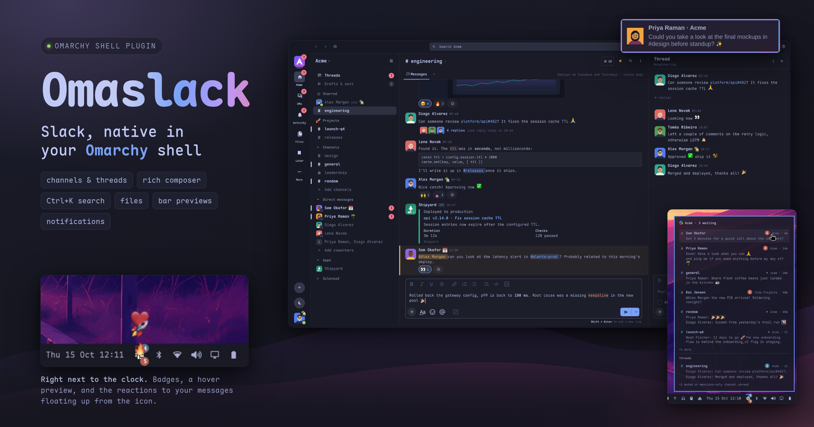
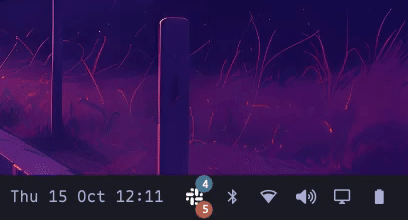
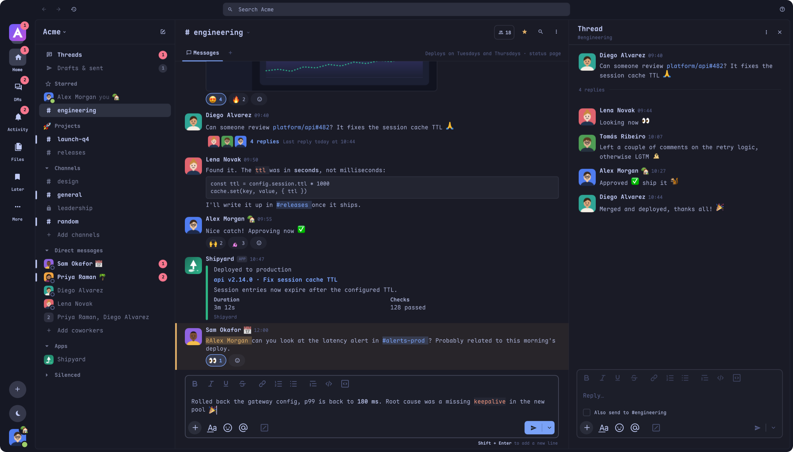
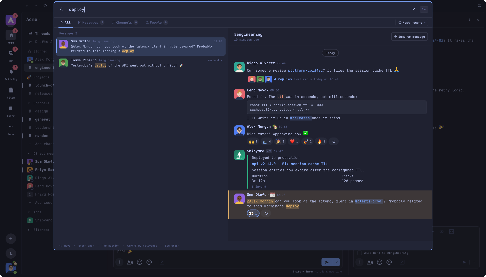
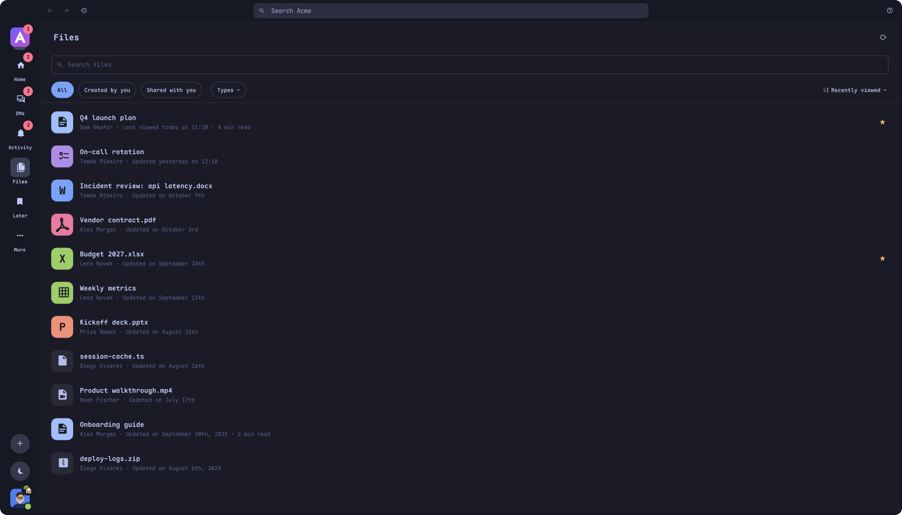
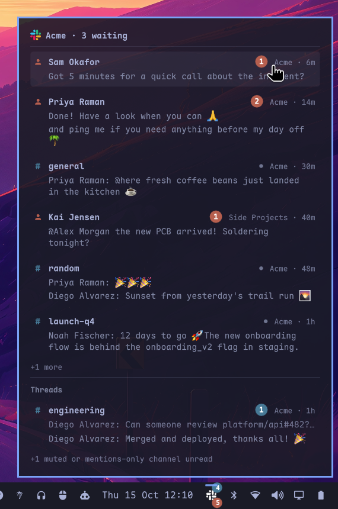
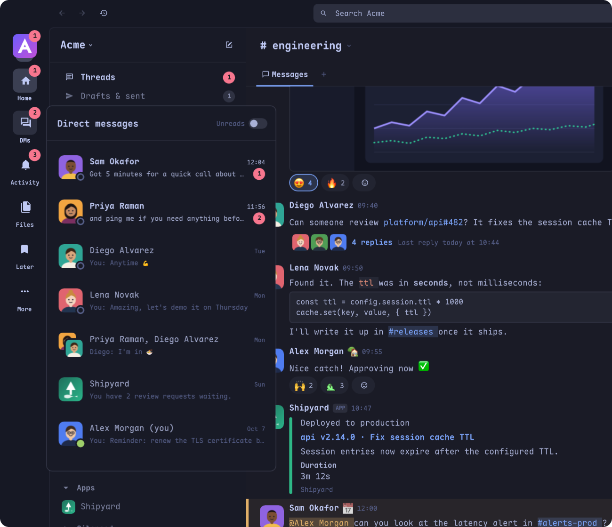
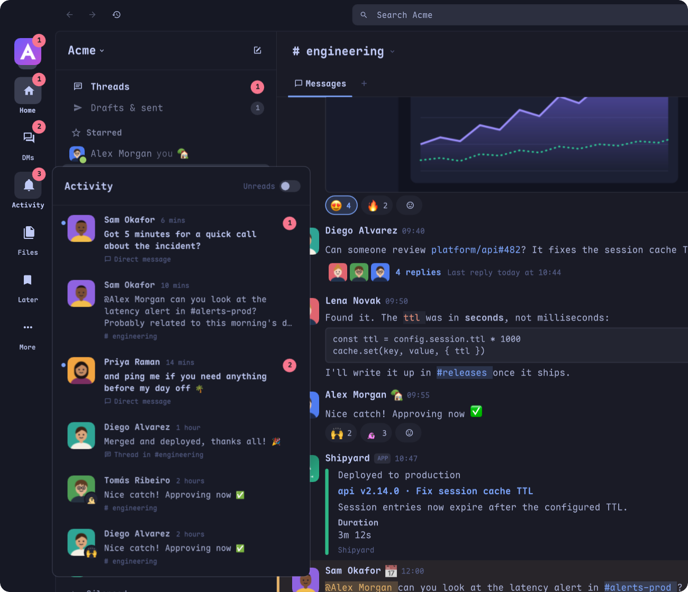
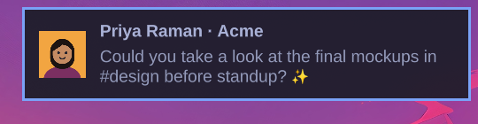

# Omaslack

**A full Slack client that lives inside the Omarchy shell, drawn in your theme's colors, with a bar widget that badges what's waiting.**

Omaslack is an [Omarchy](https://omarchy.org) shell plugin written in QML (Quickshell), with a small Python helper for the network. It shows up as Slack's mark in the bar. Click it and a window opens with Slack's familiar layout: the workspace rail, sidebar sections, conversations, threads and profiles, all in the current Omarchy theme. Inside the app it's simply called "Slack".

## Features

### The client
- **Sidebar like Slack's**: starred, custom sections with their emoji, Silenced, Channels, DMs and Apps. You can rename, create and delete sections and drag conversations between them. Unread bars and mention badges are shown, and an *Unreads* switch filters the lists.
- **Real time** over Slack's websocket: messages, edits, reactions, typing, presence and read state.
- **WYSIWYG composer** with a formatting toolbar (bold, italic, underline, strike, code, links, lists, quotes, code blocks). Slack markdown turns into formatting as you type. Mentions appear as pills and emoji as pictures. Autocomplete covers `:emoji:`, `@people`, `#channels` and `/commands`. You can attach files or paste images. Messages go out as Slack rich text, and you can edit them in place.
- **Animated custom emoji** play in messages, in reactions and inside the composer. Slack's emoji set is included, with skin tones and the workspace's custom emoji. You can switch to your system emoji font instead.
- **Threads**: a side pane, "also send to channel", and a Threads view of the threads you follow.
- **Ctrl+K search**: a quick switcher for conversations and people, plus Slack's message search with previews and its modifiers (`in:`, `from:`, `has:`, `before:`, `after:`). Deactivated people show up too, and opening one shows the **archives of the deactivated account** (their DM, read-only).
- **Files**: a rail item with a hover card of recent and starred files, and a full page with All / Created by you / Shared with you, type filters, sorting, search, download and star.
- **DMs, Activity and Later** tabs in the rail, each with a hover card, plus Drafts.
- **Message actions**: edit, delete, forward, save for later, remind, mark unread, pin, copy link, and turning reply notifications on or off for a thread.
- **Rich content**: Block Kit, attachments, apps and bots with their names and pictures, inline images and an image viewer.
- **Channels**: details (topic, description, members, notifications), rename, archive, convert, delete, invite, browse channels, and new channel or new message.
- **You**: status, away or active, pausing notifications (Slack's do-not-disturb), and editing your profile.
- **Multiple workspaces**, stacked or expanded in the rail. Ctrl+Tab and Ctrl+1…9 switch between them.
- **English and Portuguese (Brazil) UI**, chosen from your `LANG` or set in Preferences.
- Keyboard shortcuts close to Slack's (Ctrl+/ shows them all), zoom (Ctrl+= / Ctrl+- / Ctrl+0), compact or comfortable spacing, and a 12h or 24h clock.
- **In-app updater**: a green button over your photo when a new version is out (see [Updates](#updates)).

### The bar widget



- **Icon**: Slack's mark, white with a faint outline by default. Color, Mono or any Nerd Font glyph are also available. It's dimmed while you're signed out.
- **Badges**: the red one (bottom-right) counts unread DMs and group DMs, plus thread replies that mention you. The blue one (top-right) counts channel mentions, unread channels that notify you, and new replies in threads you follow. *Group notifications* folds both into one badge.
- **Hover preview**: unread conversations with their newest messages (rendered with Slack's formatting and emoji), followed threads with new replies, and the reactions people put on your messages. Click a row to jump there.
- **Desktop notifications**: one for each message that notifies you in Slack and for each reaction to your messages, with the sender's photo. They're skipped while you're paused, and for the conversation you have on screen. Clicking one opens the conversation at that message, through Omarchy's notification center.
- **Reaction emoji float up** out of the bar icon whenever someone reacts to one of your messages.
- **Scratchpad parking**: the window lives in a Hyprland special workspace (Omarchy's scratchpad by default). One click shows it and another puts it away.
- **Right-click menu**: Launch on Login, Launch in Foreground, Open in Scratchpad, Group notifications, Channel mentions only, Show threads, Show reactions, Desktop notifications, pause or resume notifications, away or active, status, Mark all as read, Preferences, and Close Slack.

| Mouse | Action |
|---|---|
| Left click | Show the window, or put it away |
| Middle click | Close the window |
| Right click | The menu |
| Hover | Preview of what's unread |

## Screenshots

| | |
|---|---|
|  |  |
| **Main window**: channels, threads, reactions, the rich composer | **Ctrl+K search** with highlighted matches and a preview |
|  |  |
| **Files**: everything shared with you, searchable | **Bar preview**: what's waiting, without opening the app |
|  |  |
| **DMs** at a glance from the rail | **Activity**: mentions, replies and reactions |



*All screenshots use the built-in demo workspace (`SLACKQS_DEMO=1`); every name and message is made up.*

## Install

```sh
omarchy plugin add https://github.com/leonavas/omaslack --enable
```

Or from your own checkout:

```sh
git clone https://github.com/leonavas/omaslack
ln -s "$PWD/omaslack" ~/.config/omarchy/plugins/leonavas.omaslack
omarchy-shell shell rescanPlugins
omarchy plugin enable leonavas.omaslack --section right
```

**Requirements**: `python3` (network and websocket), `qt6-webengine` and Qt's `qml` runtime for the sign-in window, `curl`, `notify-send`, `wl-clipboard`, `zenity` (file picker), `xdg-open`, and `pw-play` (notification sound). Most of these ship with Omarchy.

## Sign in

- **Sign in with Slack** opens Slack's own sign-in page in a separate window. Once you're in, the session (the browser token and its `d` cookie) is saved to `~/.config/omaslack/accounts.json` (mode 600) and is only ever sent to Slack. The window's web cache is deleted when it closes. Its cookies stay, so the next sign-in skips the password.
- **Sign in with a token** (the small link below the button) takes a `xoxc-…` token with its `xoxd-…` cookie, or a `xoxp-…` user token.

To add more workspaces, click the workspace icon in the rail and choose **Add a workspace**.

## Settings

- **App preferences** (Ctrl+, or the menu): notifications, sound and message preview, sidebar look, workspaces stacked or expanded, clock, spacing, emoji style, the formatting toolbar, language, zoom, your workspaces, and where the app keeps its data.
- **Bar widget settings** are in the shell's widget settings panel. You can also set them inline on the widget's entry in `~/.config/omarchy/shell.json`, for example:

  ```json
  { "id": "leonavas.omaslack", "badgeLayout": "Combined", "previewMessages": 5 }
  ```

  The available keys are listed in [`manifest.json`](manifest.json) (`barWidget.schema`): icon style, badge layout and colors, what the channel badge counts, hide mode and special workspace, auto start, hover preview size, threads, reactions, notifications, and the paused indicator.

## IPC

```sh
quickshell ipc -p "$OMARCHY_PATH/shell" call omaslack <command> [args]
```

| Command | What it does |
|---|---|
| `toggle` | Show the window, or put it away |
| `show` / `hide` | Show or hide the window |
| `open <url>` | Open a Slack permalink in the app (anything else goes to the browser) |
| `openAt <team> <conv> <ts>` | Open a conversation at a message |
| `openThread <team> <conv> <ts> <threadTs>` | Open a thread at a reply |
| `pause <minutes>` | Pause notifications in every workspace |
| `resume` | Resume notifications |
| `status` | Print JSON: signed in, what's waiting, paused, workspaces |
| `demoEvent reaction\|message` | Demo mode only: play a pretend reaction or message |

## Updates

Omaslack checks the `manifest.json` on GitHub's `main` branch a little after start-up and every 6 hours. Only that plain file is fetched, and nothing of yours is sent. When a newer version exists, a green button shows over your photo in the rail. **Check for updates** in your account menu does the same check on demand.

- **Installed with `omarchy plugin add`**: a click runs `omarchy plugin update`. The shell then reloads the plugin, and the new copy brings the window back and tells you how it went.
- **Your own checkout** (a symlink or a git clone somewhere else): the click only tells you to `git pull` in that folder.

## Data and cache

| Path | Contents |
|---|---|
| `~/.config/omaslack/accounts.json` | Your sessions (tokens and cookies), mode 600 |
| `~/.config/omaslack/settings.json` | App preferences |
| `~/.cache/omaslack/team-<id>.json` | Per-workspace cache, so the app starts fast |
| `~/.cache/omaslack/files/` | Images, avatars and files fetched with your session. Anything unused for a week is deleted |
| `~/.local/share/omaslack/webview/` | The sign-in window's profile (cookies, so the next sign-in skips the password) |
| `~/Downloads` (or `$XDG_DOWNLOAD_DIR`) | Files you download |

The XDG variables (`XDG_CONFIG_HOME`, `XDG_CACHE_HOME`, `XDG_DATA_HOME`) are respected. When you sign out of a workspace, its session and its workspace cache are removed. Preferences → Advanced opens these folders.

## Development

- `SLACKQS_DEMO=1` runs the app against a pretend workspace (`lib/Demo.js`), so no sign-in is needed.
- `SLACKQS_READONLY=1` only lets read methods reach Slack, for working against a real workspace safely.
- `SLACKQS_UPDATE_DEV=1` treats whatever is on GitHub as newer, so you can see the update button.

## Notes

- The window belongs to Quickshell (app id `org.quickshell`, shared by every window of the shell), so docks and taskbars show Quickshell's icon for it. It also tags itself in Hyprland with `icon:<plugin>/assets/slack.svg`, for widgets that read that tag.
- Not supported yet: huddles and calls, and keyword notifications (Slack's "My keywords").

## Credits and disclaimer

Made by [leonavas](https://github.com/leonavas). Licensed under the [Apache License 2.0](LICENSE).

Standard emoji names and order follow [iamcal/emoji-data](https://github.com/iamcal/emoji-data), the set Slack uses.

Omaslack is an **unofficial** Slack client. It is not affiliated with, endorsed by or sponsored by Slack Technologies, LLC or Salesforce, Inc. "Slack" and the Slack logo are trademarks of Slack Technologies, LLC. Use it in line with your workspace's policies.
